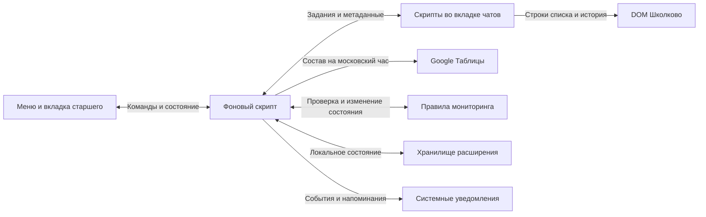

# Техническое описание «Школково — свободные чаты» для Chrome

Расширение проверяет переписки в открытой сессии Школково, сопоставляет ответы кураторов с графиком дежурств и формирует локальные уведомления. Пользователь запускает мониторинг из меню. Расширение создаёт отдельную вкладку чатов или повторно использует свою вкладку из текущего сеанса.

[Установка и использование](README.md) · [История изменений](CHANGELOG.md)

## Структура проекта

Расширение использует Manifest V3.

| Сборка | Корень расширения | Фоновый контекст и доставка уведомлений |
| --- | --- | --- |
| Chrome 120+ | [`chrome/`](chrome/) | Service worker. Уведомления через `chrome.notifications`. |

| Модуль | Ответственность |
| --- | --- |
| [`manifest.json`](chrome/manifest.json) | Разрешения, запуск фонового кода и порядок загрузки скриптов страницы. |
| [`background.js`](chrome/background.js) | Жизненный цикл мониторинга, вкладка чатов, расписание задач, хранилище, очередь уведомлений и обмен с интерфейсом. |
| [`content.js`](chrome/content.js) | Наблюдение за страницей, обход видимых и виртуализированных строк, чтение истории через интерфейс, проверка выбранной переписки. |
| [`dom.js`](chrome/dom.js) | Распознавание списка, времени активности, идентификаторов, истории, ролей, вложений и состояния подключения. |
| [`engine.js`](chrome/engine.js) | Переходы состояния, подтверждение результата проверки, время ожидания, привязки, передача и правила уведомлений. |
| [`schedule.js`](chrome/schedule.js) | Чтение недельного листа Google Таблиц и проверка состава на конкретный день и час. |
| [`time.js`](chrome/time.js) | Московские дата и час расписания и отображение меток в часовом поясе устройства. |
| [`identity.js`](chrome/identity.js) и [`curator.json`](chrome/curator.json) | Проверка имени своего куратора, нормализация и локальное переопределение. |
| [`connection.js`](chrome/connection.js) | Наблюдение за индикатором подключения чатов. |
| [`popup.*`](chrome/popup.html) и [`shift.*`](chrome/shift.html) | Меню расширения и отдельная вкладка старшего. |

## Запуск, сеанс и настройки

1. При первой настройке пользователь вводит имя и фамилию. `identity.js` приводит Unicode к NFKC, сводит варианты дефиса, апострофа и пробелов к одному виду и принимает только части имени допустимого формата. Для сравнения дополнительно учитываются различия регистра, `ё`/`е` и порядок слов. При сопоставлении с полной записью расписания версия без отчества должна определять одного человека.
2. Фоновый скрипт сохраняет имя в `storage.local`. Валидные `firstName` и `lastName` в локальном `curator.json` имеют приоритет при запуске фонового кода. Поставляемый файл содержит пустые значения. Если при включённом мониторинге применяется новое имя, фон создаёт новое поколение сеанса и передаёт имя скрипту страницы.
3. После запуска вкладка запрашивает `monitor:hello` или получает `monitor:set`. Дальнейшие сообщения сверяются с источником, вкладкой, документом и поколением сеанса. Смена документа обнуляет готовность вкладки. Проверка продолжается после регистрации нового документа.
4. Фоновый планировщик использует события вкладки, браузерные `alarms` и таймеры. Он выбирает очередную проверку истории, чтение расписания, синхронизацию страницы или доставку уведомления. Если рабочая вкладка закрылась во время мониторинга, фон открывает одну замену без фокуса и сохраняет очередь. Закрытие окна, повторное закрытие вкладки в течение минуты и ручная остановка отзывают активный сеанс. Для вкладки проверки расширение отключает автоматическую выгрузку Chrome, если браузер принимает настройку.
5. **Завершить смену и сбросить привязки** очищает записи о чатах, ожидании, привязках и очередь уведомлений. Имя куратора, режим и настройка мгновенных уведомлений сохраняются.

Основной снимок `shkolkovo.monitor.v2` в `storage.local` содержит настройки, данные расписания, признаки активности и состояние чатов, очередь проверок, очередь уведомлений и счётчики. Маркер `shkolkovo.browserSession` в `storage.session` связывает сохранённые идентификаторы вкладок с текущим сеансом браузера. При смене сеанса фон сбрасывает ссылки на старые вкладки и сохранённые маршруты перехода из уведомлений. Записи в локальное хранилище сериализованы. Результаты чтения переписки и расписания проверяются повторно перед изменением состояния, чтобы устаревший ответ не перезаписал более свежий.

## Чтение списка и переписки

1. `dom.js` извлекает из строк имя чата, курс, наличие звёздочки, признак непрочитанного, время активности и идентификаторы, если сайт их показывает. Метки без пояса разбираются в часовом поясе браузера. В `datetime` учитывается указанный пояс. Для отбора нужна метка с точностью до минуты или секунды. В работу попадает активность строго моложе 20 минут. Изменение одной звёздочки меняет признак закрепления, а событие новой активности требует отдельного подтверждения.
2. При запуске `content.js` движется от начала отсортированного списка перекрывающимися группами видимых строк до первой строки на границе 45 минут или конца списка. Фоновый процесс ставит распознанные чаты в очередь по мере прохода и сохраняет отметку завершения вместе с диапазонами пропущенных позиций. Скрипт перепроверяет пропуски пакетами не более восьми. Фон сохраняет выданный пакет до подтверждения результата, чтобы продолжить после замены документа. При последующих проходах скрипт дочитывает новый верхний участок до предыдущей отметки, а затем возвращается наверх. Отметка продвигается после непрерывного просмотра со стабильным расположением чатов на перекрытии кадров. Для позиционных пропусков сохраняются соседние строки. При перестановке скрипт повторно просматривает участок, а счётчик охвата учитывает уникальные чаты. Если сохранённым позициям не хватает соседних строк, фон запрашивает новый обзор по исходной временной границе и объединяет его с уже просмотренными данными.
3. Движок добавляет задание при новой записи, изменении времени или идентификатора последнего сообщения, переходе в непрочитанные, а также при контрольной проверке привязки или передаче. Приоритеты идут по срочности, затем по свежести и закреплению при равном времени. Для обычных чатов нужен подтверждённый состав дежурных. Закреплённый чат без привязки может быть прочитан до получения расписания.
4. Фоновое чтение выполняется в своей вкладке чатов. Начальные задания сохраняют своё окно допуска после окончания просмотра списка. Дальше в очередь попадают новые, непрочитанные и привязанные чаты с работой для проверки, включая контроль при передаче. Новые непривязанные прочитанные строки проходят в обычном 20-минутном окне. Для привязанных и непрочитанных учитывается предел 12 часов. Для поиска конкретной строки используются позиция и время. Отметка без секунд покрывает всю минуту. Для поиска временная граница подтверждается после просмотра предшествующих позиций списка. Журнал различает подтверждённую границу `row_time_boundary` и недоступный участок `row_range_unavailable`. Автоматическая навигация приостанавливается при фокусе пользователя, недавнем вводе, наличии черновика или вложения, смене страницы либо явной потере подключения. Скрипт проверяет идентификатор открытой переписки и время последнего сообщения, при необходимости подгружает до восьми страниц истории. Штатное открытие чата в Школково может менять отметку о прочтении.
5. Для истории подтверждаются порядок, время, принадлежность к выбранному чату и уникальность доступных идентификаторов. Учитывается маркер начала переписки, последний ответ куратора или сохранённое сообщение начала ожидания. Для закреплённых дополнительно проверяется участок истории после последней отметки. Неопределённость оставляет проверку в очереди, пока чат свежий. При общей блокировке вкладки очередь ждёт 10 секунд или сигнала возврата в фон либо восстановления связи. Меню и журнал показывают причину блокировки. Если устарело отдельное задание, задержка действует на него. Первые повторные проверки при ошибке распознавания планируются через 4 секунды, последующие через 5 минут в пределах окна активности.
6. Если сайт показывает время строки только до минуты и не передаёт новый идентификатор, скрипт может обнаружить добавление сообщения по изменению конца уже открытой истории. В конце минуты движок также может назначить одну контрольную проверку. Периодическая попытка синхронизации обновляет фоновую вкладку, когда она свободна и условия чтения соблюдены.

Идентификатор переписки с платформы используется как основной ключ. Временный ключ по курсу и названию служит для поиска. Записи объединяются после подтверждения общего платформенного идентификатора. Для сообщения предпочтителен идентификатор DOM, при отсутствии идентификатора в поддерживаемом резервном представлении участвуют время, автор и порядковый номер.

## Сообщения, ожидание и привязка

- Роль автора определяется из метаданных сообщения и номера участника в заголовке чата. Движок различает ученика, своего куратора, другого куратора, служебного автора и неопределённого автора. Явные обозначения ролей читаются из интерфейса Школково. Один и тот же автор сопоставляется с расписанием по имени, а сокращения и известные варианты имён принимаются при однозначном совпадении.
- Для сообщения ученика учитываются вложения и текст. Вопросительный знак, вложение или содержательный текст открывают ожидание. Одни эмодзи, знаки препинания и распознанные короткие подтверждения вроде «спасибо» или «понятно» сами по себе ожидание не открывают. Ответ куратора определяется по роли, поэтому сообщение куратора из одного эмодзи учитывается как ответ.
- Время ожидания считается с первого сообщения ученика, требовавшего ответа после последнего ответа куратора. Дополнительное сообщение ученика в том же эпизоде сохраняет исходное начало ожидания. Ответ начинает новый участок истории для подсчёта. При нехватке подтверждённой истории расширение повторяет проверку.
- Если исходная метка ожидания старше 12 часов, началом может стать первое более позднее сообщение ученика, которое требует ответа и пришло не более 20 минут назад. Подтверждённая метка сохраняется для продолжающегося ожидания. Если история подтверждает, что последнее сообщение ученика старше 12 часов, чат исключается из активной базы до изменения строки списка.
- Подтверждённый ответ куратора из текущего состава может создать привязку. Для новой привязки по обычной проверке ответ должен быть не старше двух часов. Существующая подтверждённая привязка может продолжаться. Для переписки на передаче проверяется, появился ли новый ответ после предыдущего отметочного сообщения или времени передачи.
- Свободным считается свежий непривязанный чат с подтверждённым ожиданием. Для обычного случая требуется последнее сообщение ученика, требующее ответа, и подтверждение, что последнего ответа нет, ему больше двух часов или автор последнего ответа однозначно вне текущего состава. Временные изменения активности требуют повторной проверки.
- Удаление свободного чата из списка сохраняет отметку на текущий эпизод и убирает связанные уведомления. Подтверждённое новое обращение ученика может вернуть чат в список. Снятие привязки старшим сохраняет отдельную отметку, которая предотвращает немедленную повторную привязку по той же истории. Движок снимает эту отметку при новом подтверждённом сообщении ученика.

## Расписание и передача дежурства

Настройки источника задаются через локальный `schedule-config.json` в каталоге выбранного расширения. Строковые поля `spreadsheetId` и `entryGid` задают идентификатор таблицы и опорной вкладки. Расширение показывает ошибку расписания, если конфигурация отсутствует или некорректна. [Шаблон](schedule-config.example.json) · [Порядок настройки](README.md)

`schedule.js` читает страницу списка вкладок Google Таблиц и CSV нужного листа. Запросы используют `credentials: 'omit'`, отключённый кэш, тайм-аут 12 секунд и не передают сведения о переписке. Подходящий лист должен быть единственным и иметь название с полным недельным диапазоном дат от понедельника до воскресенья. Разбор CSV учитывает кавычки, экранирование и переносы внутри значения. В строке нужного московского часа проверяются день недели, единственность строки, заголовки, персональные назначения, количество дежурных и согласованность полей «Старший» и «Веб» со списком. На выходе формируются текущий состав и справочник имён с этого листа.

Текущие дата и час расписания определяются по `Europe/Moscow` из системной метки времени. Запрос таблицы, диапазон расписания в меню и метка запроса в журнале смены используют один московский форматтер из `time.js`. Для передачи состав следующего часа вступает в работу в `:55` МСК. Меню показывает текущий календарный интервал по Москве до `:00` МСК и его местный эквивалент при разнице смещений. Тогда же начинается новый час во вкладке старшего. Местное смещение UTC рассчитывается для каждой метки отдельно, включая переход на летнее или зимнее время. В журнале событие `schedule_failed` содержит код причины, например отсутствие настройки, тайм-аут или ошибка формата.

| Момент | Действие |
| --- | --- |
| Запуск | Чтение состава на фактический текущий час в Москве. |
| `:54` | Предзагрузка состава на следующий час. Он считается свежим, если получен начиная с `:54`. При сбое возможна повторная попытка до границы. |
| `:55` | Переход на следующий состав. Фон запрашивает пассивный снимок списка. Привязки оставшихся дежурных продлеваются, свежие чаты уходящих дежурных перепроверяются по истории. |
| `:00` | Вкладка старшего начинает отображать активность нового календарного часа. Для ещё актуальной передачи может сработать повторное уведомление. |

Если состав к `:55` получить не удалось, расширение ждёт подтверждения нового состава и показывает причину сбоя расписания. Повтор для текущего периода планируется примерно через 5 минут. Подтверждённый час с нулём дежурных хранится как пустой состав. Привязки пересматриваются при смене периода и при изменении состава внутри часа. Чат переходит в подтверждённую передачу, если он ещё свежий, в переписке продолжается ожидание и после контрольной точки отсутствует новый ответ. Уведомление о передаче формируется для своего куратора при его однозначном наличии в составе, принявшем дежурство.

## Уведомления

Первое уведомление о свободном чате ставится в очередь при подтверждении. При новой активности оно ждёт повторной проверки. Эпизод отмечается оповещённым после успешной отправки в Chrome. Для передачи вместо одиночных уведомлений о каждом таком чате формируется общее уведомление с актуальным количеством. Отметка о проверенных сообщениях закреплённого чата помогает отделять новые сообщения от уже обработанных. В обоих режимах мгновенные уведомления о закреплённых включаются отдельной настройкой, учитывают подтверждённую активность и не дублируют первое уведомление о свободном, если обе причины совпали по сообщению.

| Событие | Обычный режим | Режим старшего |
| --- | --- | --- |
| Новое сообщение ученика в закреплённом | Мгновенно, когда включена настройка и чат без привязки или привязан к своему куратору. | Мгновенно, когда включена настройка и уведомления чата не отключены. |
| Ожидание в свободном чате | Первое уведомление после подтверждения, напоминания на 5, 7 и 10 минутах ожидания. | Первое уведомление после подтверждения, напоминания с 5-й минуты каждые 2 минуты. |
| Ожидание в привязанном чате | Напоминания на 5, 7 и 10 минутах для закреплённого чата своего куратора. | Напоминания с 6-й минуты каждые 2 минуты, если уведомления для чата включены. |
| Подтверждённая передача | Сводка после подтверждения, повтор в начале календарного часа и затем каждые 2 минуты, пока условия остаются в силе. | Те же правила передачи. |
| Индикатор чатов `offline` и `connecting` | Через две секунды подтверждённого `offline` после первого `online` в текущем документе. Для `connecting` действует порог 30 секунд. | Те же правила подключения. |

Если первое уведомление о свободном пришло с задержкой, уже пройденные пороги ожидания считаются обработанными. При пробуждении фонового контекста очередь использует актуальный порог, поэтому пропущенные интервалы не создают серию устаревших напоминаний. Перед показом проверяются поколение сеанса, состояние, ожидание, окно активности, режим и при необходимости состав дежурных. Ошибка доставки оставляет запись в очереди для повтора. Расширение использует сохранённый маршрут для перехода из уведомления к переписке, если привязка к вкладке и данные для навигации ещё доступны.

## Вкладка старшего и диагностика

Меню запрашивает `ui:status` и показывает состояние запуска, статус соединения, период расписания, результат просмотра списка, количество проверок, проблемных и ожидающих записей, привязки и свободные чаты. Свободные показываются по времени начала ожидания. Для действий меню использует версию записи, чтобы удалить актуальный эпизод.

Вкладка старшего получает привязанные чаты через `shift:status`. Метка активности рассчитывается по последним известным сообщениям ученика или куратора и подтверждённым данным привязки. В интерфейс попадают записи текущего календарного часа по Москве при любой длительности ожидания. Время последнего сообщения ученика берётся из `lastStudentAt`, рядом показано время последнего ответа куратора. Счётчик включает видимые строки. Таймер пересчитывает таблицу на границе часа. Напоминания работают по сохранённой привязке и её настройке `muted`, включая чаты, скрытые по времени активности в `:00`. Фон сверяет куратора и период при изменении привязки.

Сообщения `ui:*` обрабатывают меню и настройки, `shift:*` обслуживают вкладку старшего, `monitor:*` связывают фон с выбранной вкладкой Школково. В обычной работе интерфейс показывает сбой чтения расписания, отсутствие подтверждённой строки или истории, неполный просмотр свежих чатов, состояние подключения и ошибки доставки.

## Журнал смены Chrome

[`shift-log.js`](chrome/shift-log.js) сохраняет текущий журнал и очередь завершённых отчётов в состоянии `shkolkovo.monitor.v2`. Первый запуск мониторинга открывает журнал. Соседние календарные часы, в расписании которых есть куратор, составляют одну смену. При подтверждённом отсутствии куратора на следующий час журнал закрывается на границе календарного часа в Москве. Предзагрузка и передача в `:55` сами по себе журнал не закрывают. Явный ноль в проверенной строке расписания подтверждает конец смены, если состав этого часа пуст. При ошибке расписания расширение ждёт подтверждения или ручного завершения. Приостановка сохраняет текущий журнал. Ручное завершение добавляет в отчёт число снятых привязок и помещает его в очередь перед сбросом счётчиков.

После пробуждения фоновый процесс запрашивает пропущенные часы по порядку и закрывает журнал по первой подтверждённой границе. События и счётчики ожидают подтверждения состава в буфере календарного часа. При переносе в журнал смены момент начала учитывает самое раннее перенесённое событие. Для сопоставления куратора журнал использует тот же алгоритм, что и движок расписания.

Страница [настроек журнала](chrome/log-settings.html) открывается отдельной вкладкой для выбора папки через File System Access API. [`log-folder.js`](chrome/log-folder.js) хранит разрешённый дескриптор в IndexedDB и записывает файл в `logs/` внутри выбранной папки. При недоступности папки фоновый процесс использует `chrome.downloads` и сохраняет имя файла, которое вернул Chrome. Отчёт удаляется из очереди после закрытия файлового потока или подтверждения завершённой загрузки. Отдельный будильник возобновляет попытки после перезапуска фонового процесса.

Файл содержит локальное и UTC-время начала и конца, счётчики и до 1200 технических событий с UTC-метками. При переполнении сохраняется первое событие и число пропущенных строк. Диагностика использует типы событий, статусы и количественные показатели. Имена, идентификаторы, адреса страниц и содержимое чатов в файл не записываются.

## Интеграция с браузером и границы данных

[`updates.js`](chrome/updates.js) сравнивает установленную версию с полем `version` в манифесте ветки `chrome` на GitHub. Сравнение идёт по числовым компонентам. Фон проверяет версию при запуске и по отдельному будильнику с интервалом 15 минут. Результат и номер уже показанного уведомления хранятся в профиле браузера. При сетевой ошибке используется последний успешный результат. Предложение в меню ведёт на архив той же ветки, а уведомление открывает инструкцию. Обновление файлов распакованного расширения выполняет пользователь.

Используется идентификатор документа браузера при обмене с вкладкой. Обработчики Chrome Notifications поддерживают снятие маршрута при закрытии и переход к чату по нажатию. [Манифест](chrome/manifest.json) · [Фоновый скрипт](chrome/background.js)

Скрипты страницы активируются на маршруте чатов Школково. Доступ к Google Таблицам нужен для чтения расписания, а доступ к `raw.githubusercontent.com` — для проверки версии. Для уведомлений используется разрешение `notifications`. Разрешения `storage` и `alarms` обслуживают локальное состояние и возобновление работы после приостановки фона.

Для доступа к чатам используется сессия оператора в браузере. Текст сообщения и признаки вложения обрабатываются в скрипте страницы при определении необходимости ответа. Между скриптом и фоном передаются метаданные, например автор, время, роль, идентификатор и признак необходимости ответа. Снимок состояния хранится в профиле браузера и содержит метаданные для привязок, расписания, ожидания и уведомлений. В системное уведомление могут попасть название чата, имя куратора, за которым закреплён чат, и время ожидания. Запросы к Google Таблицам содержат идентификаторы таблицы и листа и параметры чтения расписания.
